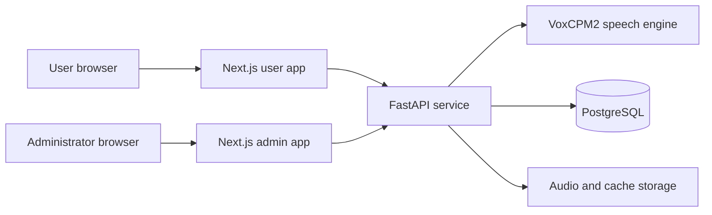

# KalapakTTS

**A Khmer text-to-speech studio powered by VoxCPM2.**

KalapakTTS brings speech generation, voice selection, pacing controls, and generation history together in a web application. It includes a user-facing studio, a separate administrator console, and a FastAPI service backed by PostgreSQL.

> **Current runtime:** Speech is generated by VoxCPM2 on the backend. Browser-based offline speech generation is not currently enabled.

## Features

- Generate Khmer speech from text, with built-in voice presets and reference-audio voice cloning.
- Stream generated audio and progress updates from the server.
- Set a speaking style, speech pace, and inference quality.
- Review, replay, download, rename, and regenerate saved generations.
- Manage users and roles from the administrator console.
- Inspect model, device, and inference status through the API.
- Optionally apply noise reduction to generated audio.

Speech style and pace settings guide the model and post-processing; they do not guarantee a particular performance or pronunciation.

## Architecture



| Component | Location | Responsibility |
| --- | --- | --- |
| User application | `frontend/` | Speech editor, voice and pace settings, playback, and history |
| Admin console | `admin/` | Usage overview, member search, and account/role management |
| API and speech service | `backend/` | Authentication, generation, administration, and audio processing |
| Speech model source | `VoxCPM/` | VoxCPM implementation used by the backend |

## Requirements

- Windows 10/11 with PowerShell (the setup below is for local Windows development).
- Python 3.10 or later.
- Node.js 20.9 or later and npm.
- PostgreSQL, with a database created for the application.
- FFmpeg available on `PATH` for audio time-stretching and optional noise reduction.
- Internet access for the initial VoxCPM2 model download (approximately 4.6 GiB).
- An NVIDIA GPU with a compatible CUDA-enabled PyTorch installation is recommended. CPU inference is supported but can be significantly slower; GPU memory requirements vary by device.

## Run locally

### 1. Configure PostgreSQL and the backend

Create a PostgreSQL database named `kalapaktts_db`. Copy the example environment file and edit the values for your machine:

```powershell
Copy-Item backend\.env.example backend\.env
```

At minimum, configure `DATABASE_URL`, a strong private `SECRET_KEY`, and a unique `ADMIN_PASSWORD`. The default local database URL format is:

```text
postgresql+asyncpg://postgres:<your-password>@localhost:5432/kalapaktts_db
```

Generate a signing key with:

```powershell
python -c "import secrets; print(secrets.token_urlsafe(48))"
```

Do not commit `backend\.env` or other credentials.

Install the backend dependencies and start the API:

```powershell
Set-Location backend
python -m venv .venv
.\.venv\Scripts\Activate.ps1
python -m pip install --upgrade pip
pip install -r requirements.txt
pip install -e ..\VoxCPM
python run.py
```

The API starts at `http://localhost:8000`; interactive API documentation is available at `http://localhost:8000/docs`. On startup, the API creates its tables and seeds the built-in voices and the administrator account (when `ADMIN_PASSWORD` is configured). The first model load downloads VoxCPM2 if it is not already cached. To download it in advance, run `.\.venv\Scripts\python.exe download_voxcpm_model.py` from `backend\`.

### Voice reference files

Some built-in voice presets require reference recordings. Provide the required audio files at the paths configured in `backend\app\main.py` before starting the API. Do not publish or commit recordings unless you have permission to share them.

### 2. Start the user application

In a new PowerShell terminal from the project root:

```powershell
Set-Location frontend
npm ci
npm run dev
```

Open `http://localhost:3000`.

### 3. Start the administrator console

In another terminal from the project root:

```powershell
Set-Location admin
npm ci
npm run dev -- --port 3001
```

Open `http://localhost:3001` and sign in using the administrator credentials configured for the backend.

Both frontends use `http://localhost:8000` as the default API URL. To use a different API host, set `NEXT_PUBLIC_API_URL` in the relevant Next.js environment file before starting or building the app.

## Configuration and data

Backend settings are documented in [`backend/.env.example`](backend/.env.example). Common options include:

| Setting | Purpose |
| --- | --- |
| `DATABASE_URL` | PostgreSQL connection string |
| `SECRET_KEY` | JWT signing secret |
| `ADMIN_EMAIL`, `ADMIN_USERNAME`, `ADMIN_PASSWORD` | Initial administrator account |
| `DEVICE` | Select `auto`, `cuda`, or `cpu` for inference |
| `MIN_FREE_VRAM_GIB` | Minimum free GPU memory for automatic CUDA selection |
| `WARM_MODEL_ON_STARTUP` | Load the model when the API starts |

Generated audio and caches are stored under `backend/audio_files/` by default. The `.gitignore` excludes environment files, model caches, generated audio, `Datasets/`, `VoiceClone/`, `backend/voice_references/`, logs, and virtual environments. Review any additional local assets before publishing; do not commit private audio or user data. Back up application data and PostgreSQL separately.

The initial model download requires internet access. Once the model is cached, the applications can run locally with the API and PostgreSQL services running. **Standalone browser-based offline generation is not supported at this time.**

## Speech generation notes

- Long text is split into sentence- and paragraph-aware chunks. Completed chunks can play while the remaining text is generated.
- The default Natural pace target is 14 speech-only characters per second. Relaxed and Brisk targets are 12 and 16 CPS; a custom target can be selected in the user app.
- Pace measurements are activity-based estimates, not word-level alignment.
- Quality presets control VoxCPM2 inference steps and trade generation time for model sampling effort.
- Style prompts and reference audio influence generation, but results vary with text, voice, and model output.
- Generation jobs are held in API memory; restarting the backend interrupts active jobs.

## Development checks

Run backend tests from `backend\`:

```powershell
.\.venv\Scripts\python.exe -m unittest discover -s tests -p "test_*.py" -v
```

Database integration tests should use a separate test database. Do not run destructive tests against the database containing application data.

Lint or build either frontend from its directory:

```powershell
npm run lint
npm run build
```

Browser tests use Playwright and require the API and user application to be running. From `frontend\`:

```powershell
..\backend\.venv\Scripts\python.exe -m unittest discover -s tests -p "test_tts_browser.py" -v
```

## Acknowledgements

KalapakTTS uses [VoxCPM](https://github.com/OpenBMB/VoxCPM) for speech generation. Model and dependency licenses are separate from the license for this application; review their terms before redistribution or commercial use.

## License

No application license has been selected yet. Add a `LICENSE` file before publishing the repository if you want to grant others permission to use, modify, or distribute this project.
